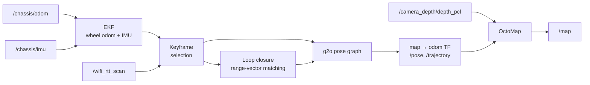

# rwifi_slam

[](https://github.com/RohanDwivedi/rwifi_slam/actions/workflows/ci.yml)
[](https://docs.ros.org/en/jazzy/)
[](LICENSE)

Wi-Fi round-trip-time (RTT) SLAM for indoor robots, built on ROS 2 Jazzy and simulated in
NVIDIA Isaac Sim.

> [!NOTE]
> **Status: research prototype.** The whole pipeline runs in simulation, but the pose-graph
> back end has known correctness issues and there is no quantitative evaluation yet. See the
> [roadmap](docs/ROADMAP.md) for what is planned and what to expect.

## How it works

Wi-Fi RTT (IEEE 802.11mc Fine Timing Measurement) measures the distance from the robot to
each access point. The project follows the idea behind
[rWiFiSLAM](https://arxiv.org/abs/2212.08418): the vector of ranges to all visible access
points works as a fingerprint of the robot's location. When the current fingerprint closely
matches one recorded earlier, the robot has probably returned to the same place. That match
becomes a loop-closure constraint that corrects accumulated odometry drift. Access point
positions are never needed.



1. An **EKF** fuses wheel odometry and IMU into `/odom_filtered`.
2. On every RTT scan, a **keyframe** is added if the robot has moved more than
   `distance_interval` or turned more than `yaw_interval`.
3. **Loop closure** compares the new keyframe's range vector with earlier keyframes, using a
   distance threshold, a ratio test, and an exclusion window for recent keyframes.
4. A **g2o pose graph** with odometry edges and robust (DCS) loop-closure edges is optimised
   whenever a loop closes. The result is published as the `map → odom` transform and on
   `/trajectory`.
5. **Depth point clouds** are inserted into an OctoMap, and a 2D slice is published as
   `/map`.

In simulation, a precomputed line-of-sight map of the Isaac Sim warehouse adds realistic
non-line-of-sight (NLOS) bias, hardware bias, and heavy-tailed noise to the true ranges.

## Repository layout

| Path | Contents |
|---|---|
| [`src/rwifi_slam_ros2`](src/rwifi_slam_ros2) | SLAM node: EKF, loop closure, pose graph, OctoMap, launch files, RViz config |
| [`src/wifi_rtt_interface`](src/wifi_rtt_interface) | RTT publisher node with an Isaac Sim backend (Android planned) |
| [`src/wifi_rtt_msgs`](src/wifi_rtt_msgs) | `APRange` and `APRangeObservation` messages |
| [`src/simulation`](src/simulation) | Isaac Sim entry point, warehouse config, NLOS map precomputation, robot and AP assets |
| [`Docker`](Docker) | Development and release images, Compose file, lint configuration |
| [`scripts`](scripts) | Docker, Isaac Sim, and host setup helpers |
| [`docs`](docs) | [Roadmap](docs/ROADMAP.md) |

## Quick start

### Requirements

- Linux x86_64 with Docker Engine and the Compose plugin
  ([`scripts/install-docker.sh`](scripts/install-docker.sh) installs both on Ubuntu 24.04)
- For the simulator only: an NVIDIA RTX GPU, a recent NVIDIA driver, and the NVIDIA
  Container Toolkit
  ([`scripts/install-nvidia-isaac-sim-dependencies.sh`](scripts/install-nvidia-isaac-sim-dependencies.sh)),
  plus about 50 GB of free disk space for an Isaac Sim build

The ROS packages build and their tests run without a GPU.

### 1. Build and enter the development container

```bash
git clone https://github.com/RohanDwivedi/rwifi_slam.git
cd rwifi_slam
docker compose -f Docker/compose.yaml run --rm dev
```

The first run builds the `rwifi_slam:dev` image. On start, the container builds the
workspace mounted at `/ros2_ws/src`, so you land in a shell with everything sourced. VS Code
users can choose **Dev Containers: Reopen in Container** instead.

### 2. Build Isaac Sim (once, for simulation)

Inside the container:

```bash
/ros2_ws/scripts/build-isaac-sim-local.sh
```

This clones Isaac Sim 6.0 into `src/simulation/isaac_sim_dev/isaac-sim-6.0/`, which is
git-ignored and persists on the host through the `src/` mount, and builds it there.

### 3. Run the SLAM stack

```bash
ros2 launch rwifi_slam_ros2 rwifi_slam.launch.py
```

This starts Isaac Sim with the warehouse scene, the RTT publisher, the SLAM node (configured
and activated by a lifecycle manager), and RViz. Drive the robot from a second shell:

```bash
ros2 run teleop_twist_keyboard teleop_twist_keyboard
```

Useful launch arguments:

| Argument | Default | Description |
|---|---|---|
| `headless` | `false` | Run Isaac Sim without its GUI |
| `launch_simulation` | `true` | Set to `false` if Isaac Sim is already running |
| `use_rviz` | `true` | Start RViz |
| `log_level` | `info` | Log level of the SLAM node |

### Run the tests

```bash
cd /ros2_ws
colcon test --event-handlers console_direct+
colcon test-result --verbose
```

## ROS interface

| Topic | Type | Direction |
|---|---|---|
| `/chassis/odom` | `nav_msgs/Odometry` | in |
| `/chassis/imu` | `sensor_msgs/Imu` | in |
| `/wifi_rtt_scan` | `wifi_rtt_msgs/APRangeObservation` | in |
| `/camera_depth/depth_pcl` | `sensor_msgs/PointCloud2` | in |
| `/odom_filtered` | `nav_msgs/Odometry` | out |
| `/pose` | `geometry_msgs/PoseWithCovarianceStamped` | out |
| `/trajectory` | `nav_msgs/Path` | out |
| `/map` | `nav_msgs/OccupancyGrid` | out |

The node broadcasts `map → odom` on TF. Parameters, frames, and launch files are documented
in the [`rwifi_slam_ros2` README](src/rwifi_slam_ros2/README.md).

## Development

See [CONTRIBUTING.md](CONTRIBUTING.md) for setup, code style, tests, and the release process.
In short:

```bash
pip install pre-commit
pre-commit install
```

CI runs the same pre-commit hooks, then builds and tests the workspace in a ROS 2 Jazzy
container.

## Roadmap

The near-term work is to make the pose-graph corrections persist, add a ground-truth
evaluation, and improve loop-closure detection. The details are in the
[roadmap](docs/ROADMAP.md).

## Acknowledgements

The approach is based on:

> B. Wei, M. Gao, F. Li, C. Luo, S. Wang, and J. Zhang, "rWiFiSLAM: Effective WiFi Ranging
> Based SLAM System in Ambient Environments," *IEEE Robotics and Automation Letters*,
> vol. 9, no. 6, pp. 5362–5369, 2024. doi:[10.1109/LRA.2024.3390548](https://doi.org/10.1109/LRA.2024.3390548),
> [arXiv:2212.08418](https://arxiv.org/abs/2212.08418)

This repository is an independent implementation and is not affiliated with the paper's
authors. It also builds on [ROS 2](https://docs.ros.org/), [NVIDIA Isaac Sim](https://github.com/isaac-sim/IsaacSim),
[g2o](https://github.com/RainerKuemmerle/g2o), and [OctoMap](https://octomap.github.io/).

## License

[Apache License 2.0](LICENSE).

## Maintainer

Rohan Dwivedi ([@RohanDwivedi](https://github.com/RohanDwivedi)), myemail.rohan@gmail.com
